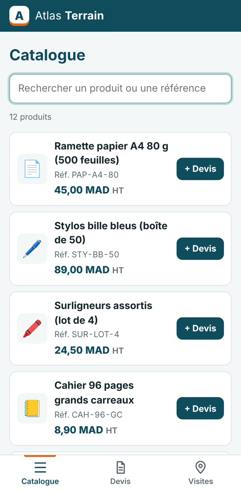
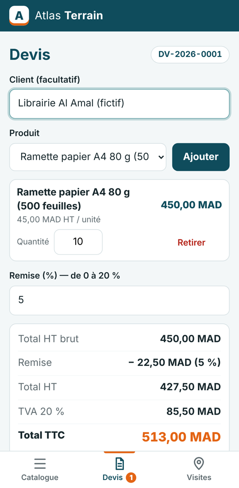
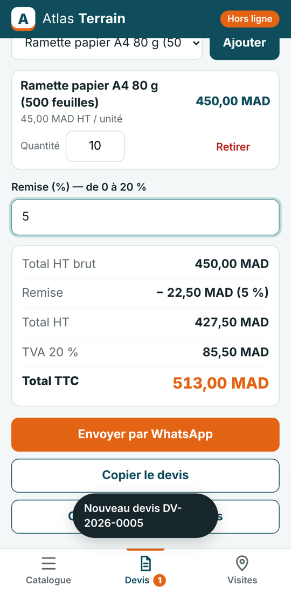

# Atlas Terrain

Application mobile des commerciaux d'**Atlas Distribution** (PME fictive de négoce) : catalogue, devis et comptes rendus de visite. Elle s'installe sur Android et iPhone et fonctionne **sans réseau**.

> **Projet pédagogique** — TP « Mission Atlas Terrain », cours « IA pour le manager », Master 2 Gestion. Produits, prix et clients sont fictifs. Ce dépôt est le **corrigé de l'enseignant**.

  

## Ce que fait l'application

| Onglet | Fonctions |
| --- | --- |
| **Catalogue** | 12 produits (nom, référence, prix HT), recherche, ajout au devis en un geste |
| **Devis** | Numéro automatique, quantités, remise plafonnée à 20 %, calcul HT / TVA 20 % / TTC, envoi par WhatsApp, copie |
| **Visites** | Compte rendu (client, date, notes), liste triée, suppression confirmée, export CSV pour Excel |

Les données restent **dans le téléphone** (stockage local du navigateur). Aucun serveur, aucun compte, aucun mot de passe.

## Les fichiers, pour un non-informaticien

| Fichier | Rôle |
| --- | --- |
| `index.html` | La structure des écrans : titres, champs, boutons, onglets |
| `style.css` | L'apparence : couleurs, tailles, mise en page sur téléphone |
| `app.js` | Le comportement : catalogue, calculs du devis, enregistrement des visites. Les règles de gestion (TVA, remise maximale) sont en tête de fichier |
| `manifest.webmanifest` | La carte d'identité de l'appli : nom, icône, couleurs, affichage plein écran |
| `sw.js` | Le « magasinier » (service worker) : garde une copie des fichiers pour le mode avion |
| `icons/` | Les icônes de l'écran d'accueil |
| `CAHIER_DES_CHARGES.md` | Le besoin, les priorités, les critères d'acceptation et les règles de gestion |
| `PROMPTS.md` | Les demandes envoyées à l'IA, dans l'ordre, pour reconstruire l'appli |
| `RECETTE.md` | Les tests réalisés et leurs résultats |

## Mettre en ligne gratuitement (GitHub Pages)

1. Créer un dépôt **public** nommé `atlas-terrain` sur GitHub.
2. Y déposer tous les fichiers de ce dossier (Add file › Upload files), en gardant le dossier `icons`.
3. Settings › Pages › Source : **Deploy from a branch** ; Branch : **main** ; dossier : **/ (root)** › Save.
4. Attendre 1 à 3 minutes (coche verte dans l'onglet Actions).
5. Ouvrir `https://VOTRE-NOM.github.io/atlas-terrain/` sur le téléphone.

## Installer sur le téléphone

- **Android (Chrome)** : ouvrir l'adresse, puis le bouton « Installer l'appli » ou le menu › « Installer l'application ».
- **iPhone (Safari obligatoirement)** : ouvrir l'adresse › Partager › « Sur l'écran d'accueil ».

Test hors ligne : ouvrir l'appli une fois avec du réseau, passer en mode avion, fermer puis rouvrir.

## Faire évoluer l'application

À chaque modification, augmenter **les deux** numéros de version, sinon les téléphones gardent l'ancienne version :

- `APP_VERSION` en tête de `app.js` ;
- `CACHE` en tête de `sw.js`.

Version actuelle : **1.3**.

## Limites connues (à discuter en séance)

- Les visites sont liées à un seul téléphone : perte ou vol du téléphone = perte des données ; pas de vue d'équipe.
- Le dépôt est public : n'y mettre aucune donnée réelle (clients, prix réels).
- GitHub Pages n'est pas destiné à héberger une activité commerciale : pour un usage réel, prévoir un hébergement professionnel.
